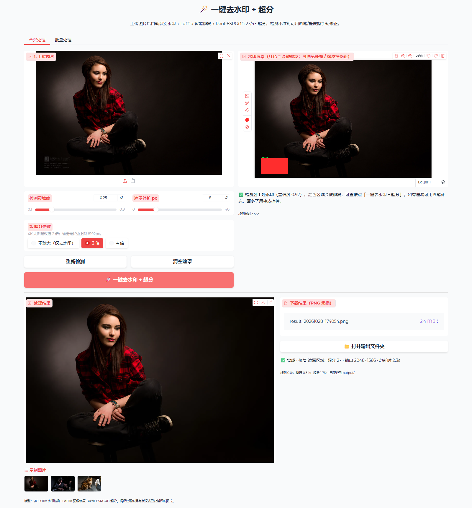
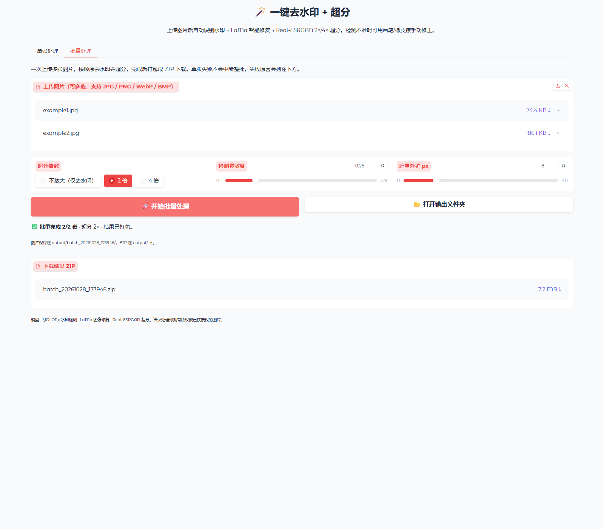
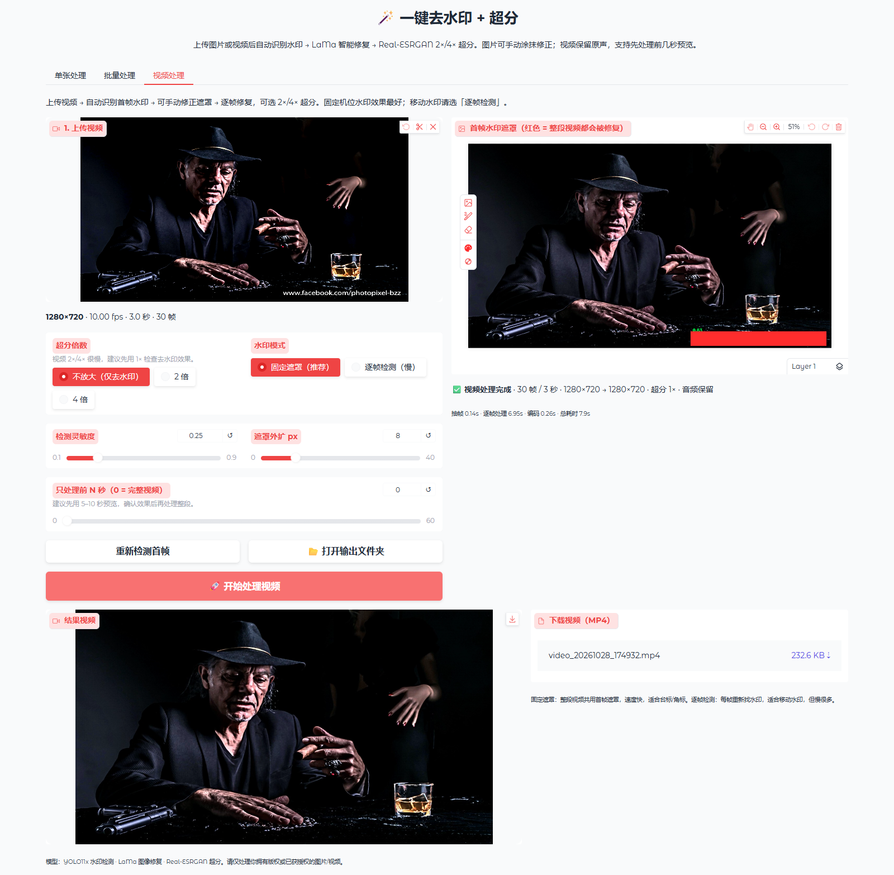

# WatermarkWipe · 一键去水印 + 超分

本地运行的图片 / 视频去水印与超分工具：**上传 → 自动检测水印 → LaMa 修复 → Real-ESRGAN 2×/4× 放大**。

支持单张精修、批量图片、视频逐帧处理；视频自动保留原声。全程本地运行，文件不会上传到任何服务器。



## 功能

- **自动检测水印/Logo**：YOLO11x 专用水印检测模型，支持角标、文字水印、Logo，中英文均可。
- **LaMa 智能修复**：大遮罩修复，自动补全被水印遮挡的背景。
- **Real-ESRGAN 超分**：2 倍 / 4 倍，分块推理，适配 8GB 显存。
- **视频处理**：逐帧去水印 + 可选超分，自动保留音轨，输出 H.264 MP4。
- **手动兜底**：检测不到或框选不准时，用画笔补充、橡皮擦修正。
- **单张 / 批量 / 视频**：网页三个标签页；命令行支持图片、视频和整个文件夹。
- **手机照片自动摆正**：读取 EXIF 方向，竖拍照片不会变成横的。

## 快速开始

### 环境要求

- Windows 10/11（主要在 Windows 11 + RTX 5060 8GB 上测试）
- Python 3.11
- NVIDIA GPU 推荐；CPU 也能跑，但会慢很多
- 首次安装依赖约 3GB，模型约 430MB

### 方式 A：Windows 脚本

```bat
git clone https://github.com/TLBtianhu/watermark-wipe.git
cd watermark-wipe

:: 1. 创建虚拟环境并安装依赖（约 3GB）
install.bat

:: 2. 下载模型（约 430MB）
python download_models.py

:: 3. 启动
start.bat
```

浏览器会自动打开 <http://127.0.0.1:7860>。首次启动约 20 秒。

> 国内网络下载慢时，可以先设置代理再运行：
> `set HTTPS_PROXY=http://127.0.0.1:7897`
> 或 `python download_models.py --proxy http://127.0.0.1:7897`

### 方式 B：直接下载 Windows 安装版 EXE

不想装 Python，可以从 [Releases](https://github.com/TLBtianhu/watermark-wipe/releases/latest) 下载安装包：

- `WatermarkWipe-v1.0.1-win64-Setup.exe`
- `WatermarkWipe-v1.0.1-win64-Setup-1.bin`
- 如果有 `...-Setup-2.bin` 也一起下载

把全部文件放在**同一个文件夹**，双击 `Setup.exe` 安装。

安装到 `%LOCALAPPDATA%\Programs\WatermarkWipe`，自动创建开始菜单快捷方式（安装时可勾选桌面快捷方式），完成后可直接启动。

- 已内置 4 个模型，安装后离线可用
- 需要 Windows 10/11 64 位 + 支持 CUDA 12.8 的 NVIDIA 驱动
- 首次启动约 10–20 秒（加载 PyTorch/CUDA）
- 处理结果保存在安装目录的 `output/`
- 安装包较大（约 2.3GB），因此拆成 exe + bin 分卷；缺少 bin 会安装失败

### 方式 C：手动安装

```bat
python -m venv venv
.\venv\Scripts\activate
pip install -r requirements.txt
python download_models.py
python app.py
```

模型权重不放进 Git 仓库，必须运行一次 `download_models.py`。

## 使用

### 单张处理

1. 打开「单张处理」标签，上传图片。
2. 程序自动检测水印，红色区域 = 会被修复。
3. 检测不准时用画笔补充、橡皮擦修正。
4. 选择超分倍数，点 **🚀 一键去水印 + 超分**。
5. 右侧下载 PNG。

| 控件 | 说明 |
| --- | --- |
| 检测灵敏度 | 默认 0.25；检测不到调到 0.10–0.15，误检多时调高 |
| 遮罩外扩 | 默认 8px，把水印边缘也盖住，避免残留 |
| 超分倍数 | 仅去水印选“不放大”；一般 2 倍；4 倍适合小图 |

### 批量处理

切到「批量处理」标签，一次选择多张图片，设置倍数后点「开始批量处理」。完成后下载 ZIP；单张失败不会中断整批。



### 视频处理

切到「视频处理」标签：

1. 上传 MP4 / MOV / MKV / AVI / WebM。
2. 自动检测**首帧**水印，红色遮罩会应用到整段视频。
3. 检测不准时用画笔修正。
4. 选择超分倍数（建议先用 1× 检查去水印效果）。
5. 长视频先把「只处理前 N 秒」设为 5–10 秒预览。
6. 点 **🚀 开始处理视频**，完成后播放或下载 MP4。



- **固定遮罩（推荐）**：整段视频共用首帧遮罩，速度快，适合台标、角标、固定位置文字水印。
- **逐帧检测**：每帧重新检测，适合移动水印，但慢很多。
- **音频保留**：源视频有音轨时自动保留为 AAC 192k。
- **输出格式**：H.264 MP4，兼容常见播放器和剪辑软件。

> 视频是逐帧 LaMa 修复，没有专门的时序模型。固定机位、静态背景效果最好；水印压在大面积移动物体上时可能有轻微闪烁。
>
> 想先试跑：可以使用 `samples/example_video.mp4`（3 秒、1280×720、带音频、带水印）。

## 命令行

```bat
:: 单张图片，2 倍超分
.\venv\Scripts\python.exe cli.py 图片.jpg -s 2

:: 整个文件夹批量处理
.\venv\Scripts\python.exe cli.py 某个文件夹 -s 2 -o output\批量结果

:: 只去水印，不放大
.\venv\Scripts\python.exe cli.py 图片.jpg -s 1

:: 手动遮罩（白色=修复区域）
.\venv\Scripts\python.exe cli.py 图片.jpg -m mask.png -s 2

:: 视频默认 1 倍（仅去水印），自动保留音频
.\venv\Scripts\python.exe cli.py 视频.mp4

:: 视频 2 倍，只处理前 5 秒预览
.\venv\Scripts\python.exe cli.py 视频.mp4 -s 2 --preview 5

:: 移动水印：逐帧检测
.\venv\Scripts\python.exe cli.py 视频.mp4 --mode per_frame --preview 10
```

常用参数：`-c` 检测阈值、`-e` 遮罩外扩、`--preview` 视频预览秒数、`--mode fixed/per_frame`、`--device cpu` 强制 CPU。

## 模型

运行 `python download_models.py` 自动下载到 `models/`：

| 模型 | 用途 | 大小 | 来源 | 许可 |
| --- | --- | --- | --- | --- |
| `watermark_yolo11x.pt` | 水印/Logo 检测 | 109 MB | [corzent/yolo11x_watermark_detection](https://huggingface.co/corzent/yolo11x_watermark_detection) | 模型卡标注 MIT；基于 Ultralytics YOLO11（AGPL-3.0），作者限定研究/教育用途 |
| `big-lama.pt` | LaMa 图像修复 | 196 MB | [IOPaint / big-lama](https://github.com/Sanster/models/releases/tag/add_big_lama) | LaMa 为 Apache-2.0 |
| `RealESRGAN_x2plus.pth` | 2 倍超分 | 64 MB | [Real-ESRGAN](https://github.com/xinntao/Real-ESRGAN) | BSD-3-Clause |
| `RealESRGAN_x4plus.pth` | 4 倍超分 | 64 MB | [Real-ESRGAN](https://github.com/xinntao/Real-ESRGAN) | BSD-3-Clause |

技术栈：Python 3.11 + PyTorch 2.9.1 (CUDA 12.8) + Ultralytics + Spandrel + Gradio 6 + FFmpeg。

## 性能参考

测试环境：RTX 5060 Laptop 8GB，Ryzen 9 9955HX，32GB RAM。

### 图片

| 输入 | 操作 | 耗时 |
| --- | --- | --- |
| 1024×683 | 去水印 + 2× | ≈ 3–5 s |
| 1600×1067 | 去水印 + 2× | ≈ 5–6 s（首次含加载约 8–11 s） |
| 2048×1365 | 去水印 + 2× | ≈ 13 s |
| 1024×683 | 去水印 + 4× | ≈ 10 s |

### 视频

逐帧处理，耗时与分辨率、时长、倍数直接相关。水印在角落时 LaMa 只修复局部，会明显更快。

| 视频 | 操作 | 速度 |
| --- | --- | --- |
| 1280×720 10fps | 去水印 1× | ≈ 0.2–0.3 s/帧 |
| 1280×720 10fps | 去水印 + 2× | ≈ 1.5–2 s/帧 |
| 1080p 30fps 10 秒 | 去水印 1× | ≈ 1–2 分钟 |
| 1080p 30fps 10 秒 | 去水印 + 2× | ≈ 8–12 分钟 |

建议先用「只处理前 N 秒」预览，确认遮罩和效果后再跑完整视频。

## 项目结构

```
watermark-wipe/
├─ app.py                  # Gradio 网页界面
├─ cli.py                  # 命令行（图片/视频/文件夹）
├─ download_models.py      # 下载并校验模型权重
├─ core/
│  ├─ pipeline.py          # 检测 → 修复 → 超分 流水线
│  ├─ detector.py          # YOLO11x 水印检测
│  ├─ lama.py              # LaMa 修复（支持局部裁剪加速）
│  ├─ esrgan.py            # Real-ESRGAN 超分
│  ├─ video.py             # 抽帧、逐帧处理、音频重编码
│  └─ utils.py             # 中文路径、EXIF、遮罩处理
├─ models/README.md        # 模型说明（权重不入库）
├─ samples/                # 示例图片/视频
├─ assets/                 # README 截图
├─ output/                 # 处理结果（不入库）
├─ install.bat             # 安装依赖
├─ start.bat               # 启动
├─ build.bat               # 打包 Windows EXE
├─ WatermarkWipe.spec      # PyInstaller 配置
├─ installer.iss           # Inno Setup 安装器脚本
├─ requirements.txt
├─ LICENSE                 # AGPL-3.0
└─ .gitignore
```

## 构建 EXE

```bat
build.bat
```

输出在 `dist\WatermarkWipe\`，整个目录可以独立运行。模型和示例会一起打进 `_internal`，所以体积较大（约 5GB），但解压即用、离线可跑。

生成 Windows 安装器需要 [Inno Setup 6](https://jrsoftware.org/isinfo.php)：

```bat
ISCC.exe installer.iss
```

输出 `release\WatermarkWipe-v1.0.1-win64-Setup.exe` 和同目录的 `.bin` 分卷，安装包总体积约 2.3GB。

## 常见问题

**检测不到水印？**
把“检测灵敏度”降到 0.10–0.15 再点“重新检测”；仍不行就直接用画笔把水印涂红。半透明、被压缩过、面积很小的水印可能需要手动涂抹。

**修复后有残影？**
把“遮罩外扩”调大一些（12–20px），或手动把水印边缘多涂一点。LaMa 需要完整覆盖水印才能补干净。

**显存不足 / CUDA out of memory？**
选 2 倍而不是 4 倍；关闭游戏或其他占显存的程序。LaMa 会自动降分辨率，Real-ESRGAN 已分块处理。视频建议先用 1×。

**端口被占用？**
程序会自动尝试 7860–7879，控制台会打印实际地址；也可以设置环境变量 `GRADIO_SERVER_PORT=7870`。

**视频处理很慢？**
视频是逐帧修复 + 逐帧超分。先选 1×、把“只处理前 N 秒”设为 5–10 秒预览；2×/4× 会比 1× 慢 6–10 倍。固定遮罩比逐帧检测快很多。

**视频没有声音？**
源视频本身没有音轨时，输出也不会有音频；源视频有音轨时会自动保留为 AAC。

**想用 CPU？**
启动会慢很多（超分可能几分钟），命令行加 `--device cpu`；网页版默认自动用 GPU。

## License

本项目使用 **GNU Affero General Public License v3.0（AGPL-3.0）**，见 [LICENSE](LICENSE)。

原因是项目依赖 Ultralytics YOLO11（AGPL-3.0）。如果你要在闭源项目中使用，需要替换水印检测模型，或向 Ultralytics 获取商业许可。

模型权重有各自许可，详见 [models/README.md](models/README.md)。权重不随仓库分发。

## 说明

- 请仅处理你拥有版权或已获得授权的图片/视频。去水印模型的使用条款限定为研究/教育用途，请遵守对应模型许可。
- `samples/` 和 `assets/` 中的示例照片来自检测模型仓库，仅用于功能演示，版权归原作者；如不需要可删除这两个目录并调整 README。
- 程序只监听 `127.0.0.1`，不会暴露到局域网。

如果这个项目对你有帮助，欢迎 Star ⭐
